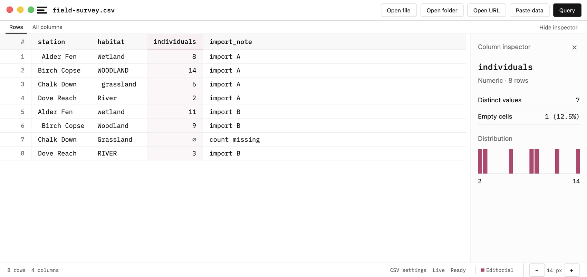
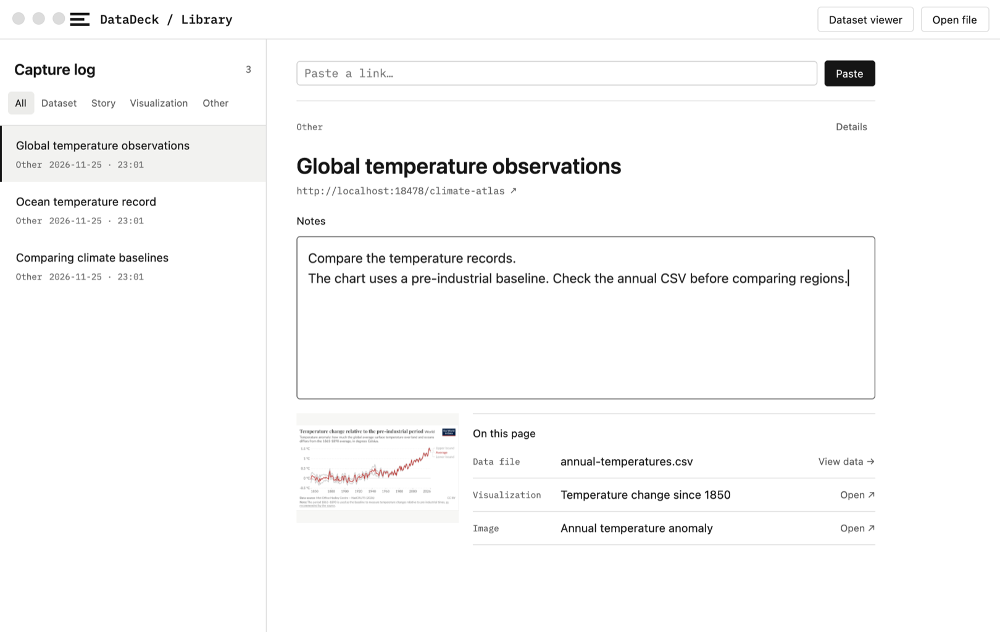
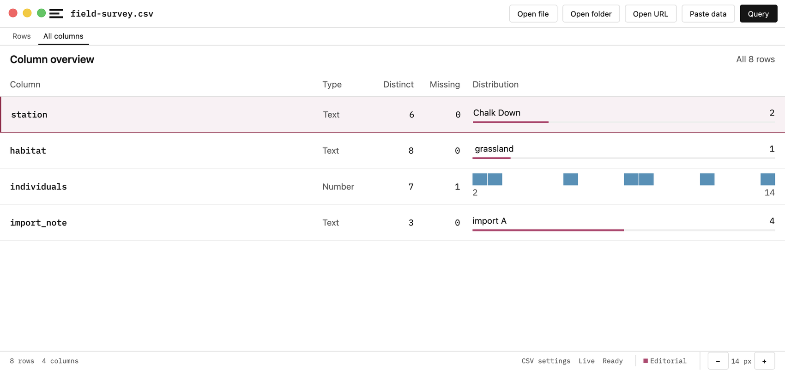

# DataDeck

DataDeck is a native GPUI desktop viewer for CSV, TSV, Parquet and Excel. Open a local file or paste its HTTP(S) download URL, inspect a distribution beside the table, and query the open dataset. Choose **Explore the field notes example** in the empty **Dataset viewer** to try it with a small fictional survey.

[Start the pictured cleaning tutorial](docs/quickstart.md) · [Watch the overview](docs/videos/overview.mp4) · [Watch inspection](docs/videos/inspect.mp4) · [Watch cleaning and replay](docs/videos/clean.mp4)

## Install a tagged release on macOS

Open the [DataDeck releases page](https://github.com/datasets/datadeck/releases), choose the macOS 15+ disk image for your Mac (Apple silicon or Intel), open it, and drag DataDeck into Applications. Published disk images require Developer ID signing and Apple notarization. The [release guide](docs/releases.md) covers version tags, GitHub Actions, signing credentials, and preview builds. Until the first signed release is published, build from source below.

## Run on macOS

Install Rust and Xcode, then run from the repository root:

```sh
cargo run --locked
```

To build a Finder application, run `scripts/package-macos.sh` and open `target/release/DataDeck.app`. For a development bundle, use `scripts/package-macos.sh --dev`. You can also open a dataset directly:

```sh
cargo run --locked -- examples/field-notes.csv
cargo run --locked -- https://datahub.io/core/co2-ppm/_r/-/data/co2-annmean-mlo.csv
```



## Command line

The release build places `datadeck` in `target/release/`. Run the commands below from the repository root after building with `scripts/package-macos.sh`. For the Finder bundle, the same executable is `DataDeck.app/Contents/MacOS/datadeck`.

```sh
./target/release/datadeck                                        # Open your recent Library
./target/release/datadeck --library                              # Browse saved web links
./target/release/datadeck examples/field-survey.csv              # Open one file
./target/release/datadeck examples                               # Browse a folder or checkout
./target/release/datadeck /path/to/datapackage.yml               # Open a package
./target/release/datadeck https://datahub.io/core/co2-ppm/_r/-/data/co2-annmean-mlo.csv
./target/release/datadeck run examples/clean-field-survey.sql examples/field-survey.csv > cleaned.csv
./target/release/datadeck --help
```

For a `datadeck` command on your Rust toolchain’s PATH, run `cargo install --path . --locked`. You can then omit `./target/release/` from these examples.

Use a single file or direct download URL as the input to `run`. It writes the full query result as CSV on standard output. The replay options are `--sheet NAME`, `--delimiter comma|tab|semicolon|pipe`, and `--header yes|no`. A folder path opens the resource browser in the desktop app. Filenames containing spaces work inside shell quotes.

## Capture a link and jot down a note

Open DataDeck and paste a link, or drag one from your browser onto the window. It goes straight into your local capture log. Paste a sentence and a link together and DataDeck extracts the address and keeps your words as the note. A spreadsheet block pasted into the viewer still opens as a table.

The large notes area is ready while the spinner is running. Type, paste several paragraphs, or use your Mac’s Dictation shortcut. Notes save automatically. **⌘L** moves focus to the capture field for the next link. [Using macOS Dictation](https://support.apple.com/guide/mac-help/mh40584/mac)

In the background DataDeck reads the page title, looks for preview images, chart links and embeds, and finds linked CSV, TSV, Excel and Parquet files. Choose a discovered data file to open it in the viewer. Images, visualizations and **Open page** take you to the original in your browser. The preview uses the HTML the site returns. A site that generates links only after running JavaScript may supply fewer results.

Reopen DataDeck to see the newest captures first. Capturing a URL again moves that entry to the top and keeps its notes. Reading or editing an older note leaves its place in the log intact. The URL, notes, discovered links and cached thumbnail live in `~/Library/Application Support/DataDeck/library.sqlite3` on macOS. Finder internet shortcuts (`.webloc`) work too.



[Watch the narrated capture walkthrough](docs/videos/library.mp4).

## Open and inspect

Drop a file or directory on the window, choose **Open file** (⌘O) or **Open folder** (⇧⌘O), or paste a direct HTTP(S) download link into **Open URL** (⌘L). DataHub resource links work directly. The planned dataset-page browser and publishing flow are described in [DataHub integration](docs/datahub.md).

**CSV and TSV.** DataDeck samples the opening records to guess comma, semicolon, tab or pipe delimiters and whether the first record contains headers. Quoted multiline fields, UTF-8 BOMs and Excel-style `sep=` directives are supported. Short rows have empty trailing cells. Long rows add named columns even when they appear late in a file. The status bar indicates extra fields. Click **CSV settings** to correct the delimiter or header guess, or choose **Detect again**. For ambiguous all-text data, check the header setting.

**Excel.** Each worksheet has a named tab above the grid. Click a tab to inspect or query that sheet. Its first row supplies the headers. Scroll horizontally through the tabs in a workbook with many sheets. [See an example workbook with two sheets](docs/images/workbook-sheets.png).

**Folders and Data Packages.** Open a folder, Git checkout, or a `datapackage.json`, `datapackage.yml` or `datapackage.yaml` file. A descriptor supplies the resource list in package order and can reference local files or HTTP(S) downloads. Without one, DataDeck searches for supported tables and skips hidden, dependency and build directories. Click the folder and resource name above the grid to switch tables. Each file in a multipart resource is available individually.

**Live files.** Local saves and atomic replacements refresh the selected file after writes settle. The app swaps in the new data after a successful read and reruns a visible query. The selection follows the column name and row position. The query editor retains unsent text. A failed refresh leaves the last successful view available. Live monitoring applies to the selected local file. Reopen the folder to discover newly added resources.

**Clipboard.** Choose **Paste data** or press ⌘V with the table focused to open copied CSV, TSV, or spreadsheet cells as a dataset. Pasting into the URL or query field enters text there. To copy data out, select a cell, extend a rectangle with Shift-click or Shift-arrow, and press ⌘C. A range copies as tab-separated cells for pasting back into a spreadsheet.

Choose **All columns** to compare the profiles of every field in the source or query result. Click a field to inspect its values in the grid. **Hide inspector** or **×** closes the detail panel. **Show inspector** reopens it.

Click a column header to inspect its values. Numeric columns show a histogram and range. Text columns show their most frequent values. The inspector shows distinct and empty counts and identifies its sample, up to the first 1,024 rows. An ordered file can therefore have a different full-file distribution. Use SQL for exact totals across all rows. Select a cell to inspect or copy its contents. Use the arrow keys, Page Up/Down, Home or End to navigate and **I** to toggle the inspector.

Use **−** and **+** next to the text size in the status bar to adjust the table and inspector between 9 and 20 px. The default is 11 px. The **View** menu has the same controls and a reset command (⌘0). Click **Editorial** in the status bar, or use **View**, to switch between colored data marks and Monochrome. DataDeck remembers both settings.



## Query and repeat

For a worked example with pictures and a runnable recipe, see [Clean a field survey and replay it](docs/quickstart.md).

Open **Query** (⌘K) and press Enter to run a single SQLite query against the table `data`. The first query builds a temporary local database from the loaded rows. Subsequent queries reuse it. The table `data` always contains the original input, including when **Result** is visible. Combine cleaning steps in one query, or reopen the exported CSV to use it as the next input. Switch between **Source** and **Result** to compare the two. The desktop previews up to 10,000 result rows and reports the total.

For the bundled example, try `how many rows per habitat?`, `which habitat is most common?`, or `average temp_c by habitat`. These questions use a local grammar and turn into editable SQL in the same field. For other questions, enter SQL directly or paste a query written by an AI assistant.

To clean text and keep only the columns you need, run:

```sql
SELECT trim(station) AS station, survey_date, individuals
FROM data
ORDER BY survey_date, station
```

Use **Save last query…** to freeze the successful query into a script. A SQL comment records the selected sheet and CSV import settings for replay. Replay it on a second file with matching column names and redirect its full result to a new CSV:

```sh
cargo run --locked -- run recipe.sql next-survey.csv > cleaned.csv
cargo run --locked -- run recipe.sql workbook.xlsx --sheet Observations > cleaned-sheet.csv
```

The source viewer retains the displayed strings in memory. SQL projections preserve cell spelling, including padded identifiers, trailing zeros and high-precision decimals. Empty cells become NULL. Canonically spelled integers and decimals become numbers when they round-trip through SQLite’s numeric types. Numeric prompts also recognize decimal and exponent text. Arithmetic uses SQLite integer or floating-point precision. Use double quotes around identifiers with spaces. Excel uses cached cell values. CSV streams into the viewer in batches. Remote Excel and Parquet downloads finish before decoding starts.

To override a recipe’s import settings, add `--delimiter comma|tab|semicolon|pipe` or `--header yes|no`.

## Performance and large files

The grid draws the visible rows and columns. File decoding runs off the UI thread. CSV sends the first 64 data rows to the viewer, then switches to batches of 2,048 so you can start inspecting while the rest loads. The inspector and all-column overview profile up to the first 1,024 rows. SQL builds its temporary database on the first query, reuses it for later queries, and computes over the full dataset. The desktop keeps up to 10,000 query-result rows for display. CLI replay emits the complete result.

We tested the optimized macOS app on an Apple M4 with 32 GB of RAM using the same 1,000,000 station observations in both formats. Both desktop windows reported 1,000,000 rows and four columns. A SQL count, ID range, and observation sum agreed across both files.

| Local input | File size | Desktop resident memory after opening | CLI import plus full-table aggregate |
| --- | ---: | ---: | ---: |
| CSV | 25.8 MB | 277 MiB | 0.92 s |
| Snappy Parquet | 6.25 MB | 493 MiB | 1.27 s |

The times are the medians of three warm-file CLI runs and include process startup, decoding, SQLite import and the query. Memory is a post-load process sample, so peak memory can be higher. The desktop retains decoded cells in RAM. Wide tables and long text can consume substantially more memory at the same row count, and compressed Parquet size alone is a poor guide to memory use. Remote Parquet and Excel files download before decoding. These measurements are for local files.

For a parser-only check, run `cargo test --locked --release million_row_csv -- --ignored --nocapture`. On the same Mac, this separate generated 29.8 MB CSV delivered its first batch to the row callback in 0.44 ms and all one million rows in 337 ms. Window rendering and SQLite are outside that measurement.

## Development

```sh
cargo test --locked
cargo fmt --check
```

See the [design rationale](DESIGN.md) for the viewer, inspector, query and recipe decisions. Project work is tracked in the **Ship a fast native tabular data viewer** Beads issue (`datadeck-pxw`).
