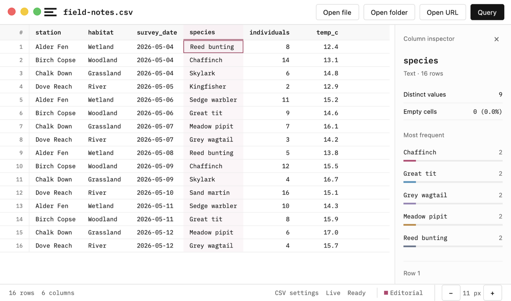

Open CSV, Parquet and Excel files from disk or a download URL in DataDeck. Inspect column distributions, ask a question in SQL or plain language, and save a transformation to run again on another file. [Try the desktop viewer](https://github.com/datasets/datadeck#readme)

Open a workbook by sheet or a Data Package by resource. Local files refresh after saves, and CSV import settings let you correct delimiter and header guesses.

