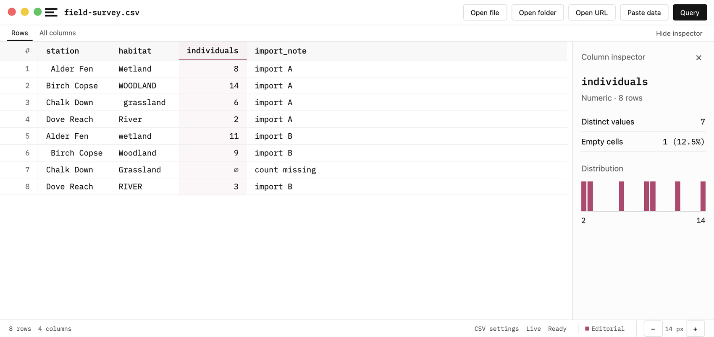
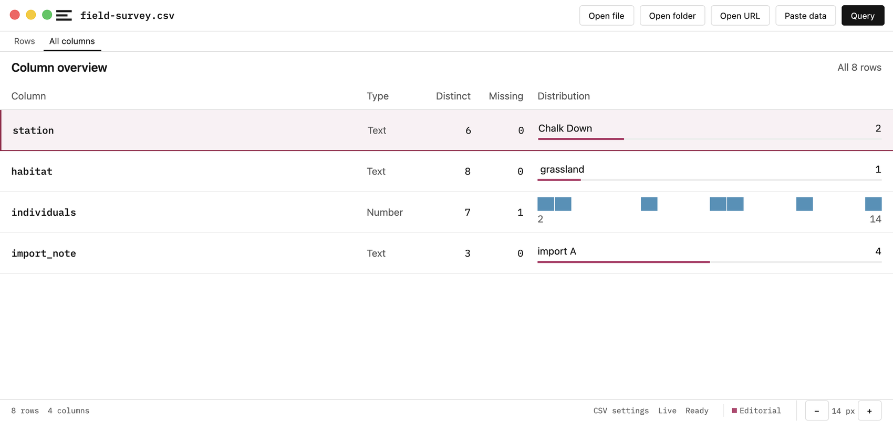
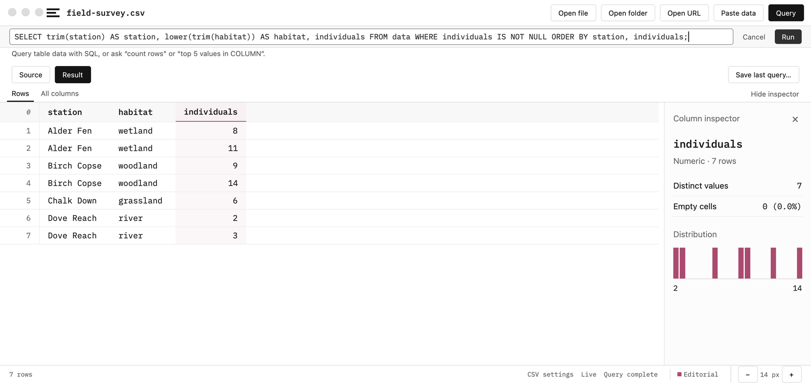

# Clean a field survey and replay it

Start with eight field observations. By the end you’ll have seven clean rows, three columns, and a SQL recipe you can run on another survey. The [input CSV](../examples/field-survey.csv) and [finished recipe](../examples/clean-field-survey.sql) are included.

For a first build on macOS, run `scripts/package-macos.sh` in the repository root. [macOS installation instructions](../README.md#run-on-macos).

Watch the [app overview](videos/overview.mp4), [inspection tutorial](videos/inspect.mp4), or [cleaning and replay tutorial](videos/clean.mp4). Each video has narration and optional English captions.

## 1. Open the survey

From the Library or an open table, choose **Open file**. In the empty dataset viewer, choose **Choose file…**. Select `examples/field-survey.csv`. From the repository root, the equivalent command is:

```sh
./target/release/datadeck examples/field-survey.csv
```



**Other ways in.** Use **Paste data** for a block of cells copied from a spreadsheet. Use **Open folder** for a whole project. The first resource opens, and clicking the folder and resource name above the grid lists the others. A Data Package supplies their names and order.

## 2. Inspect before changing anything

Choose **All columns**. In the `individuals` row, **Missing** is 1. One observation has no count. Select `habitat` to inspect its source values. The rows contain both `Wetland` and `wetland`, which will form separate groups until you standardize them. The sample indicator tells you how many rows the profiles cover.



Click **Hide inspector** or **×** for a full-width table and **Show inspector** to bring the panel back. If a CSV was split incorrectly, open **CSV settings** in the status bar to choose the delimiter and whether the first row contains headers.

## 3. Write a cleaning recipe

Open **Query** (⌘K on macOS), paste the following SQL, and press Return or click **Run**. The table named `data` holds the original eight records, including when **Result** is visible. Add each cleaning step to the same query.

```sql
SELECT
    trim(station) AS station,
    lower(trim(habitat)) AS habitat,
    individuals
FROM data
WHERE individuals IS NOT NULL
ORDER BY station, individuals;
```

| What you want to do | What the recipe does |
| --- | --- |
| Remove extra spaces | `trim(station)` cleans the station name. |
| Standardize text | `lower(trim(habitat))` turns values such as `WOODLAND` into `woodland`. |
| Remove a column | The `SELECT` list names the three fields to keep. It leaves out `import_note`. |
| Handle missing data | `WHERE individuals IS NOT NULL` drops the row with an unknown count. A real zero would stay. |
| Make the output order repeatable | `ORDER BY station, individuals` sorts by station, then by count. |



Choose **Source** to see the original eight rows. Choose **Result** to return to the seven cleaned rows. Running a query leaves the source file intact.

## 4. Save it and run it again

Click **Save last query…** and save it in the repository root as `clean.sql`. The saved file records the active sheet or CSV import settings in a SQL comment. Replay your saved recipe from that directory:

```sh
./target/release/datadeck run clean.sql examples/field-survey.csv > cleaned-survey.csv
./target/release/datadeck cleaned-survey.csv
```

You can substitute `examples/clean-field-survey.sql` for `clean.sql` to try the supplied recipe directly. The first two output records should be `Alder Fen,wetland,8` and `Alder Fen,wetland,11`. For your next survey, reuse the same recipe and replace the input path. Send output to a different file from the input because shell redirection opens the output before DataDeck starts.

For a quick question, enter `count rows` or `how many rows per habitat?` in **Query**. DataDeck shows the generated SQL. You can edit that SQL or paste a query from an external AI assistant into the same field.
